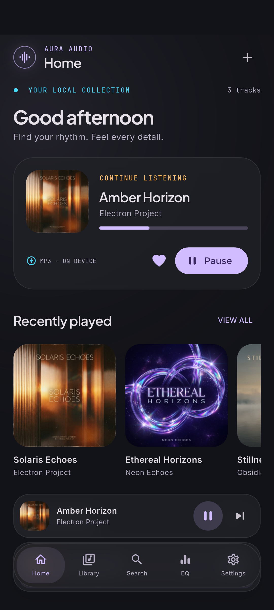
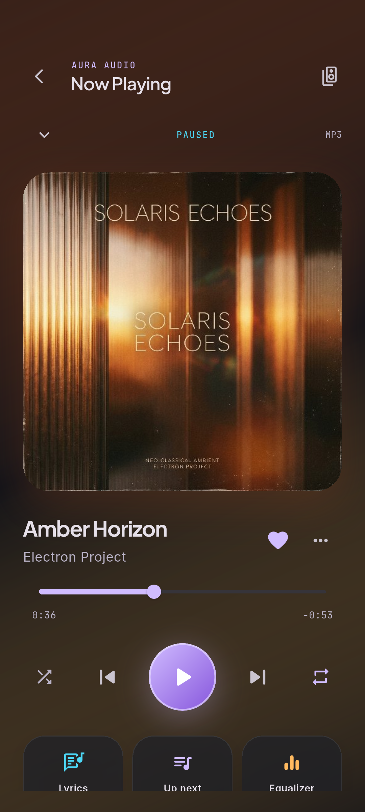
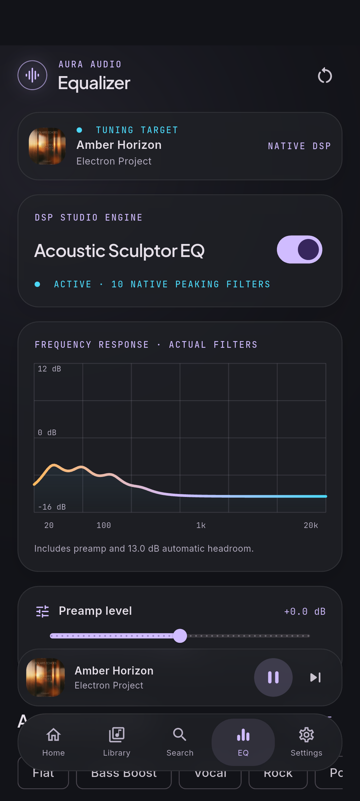
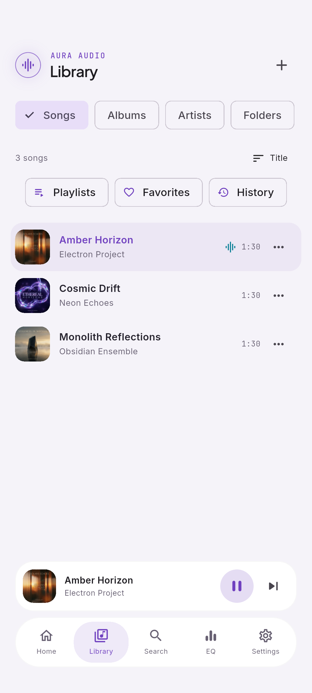
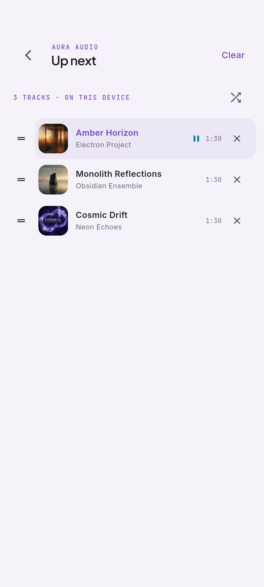
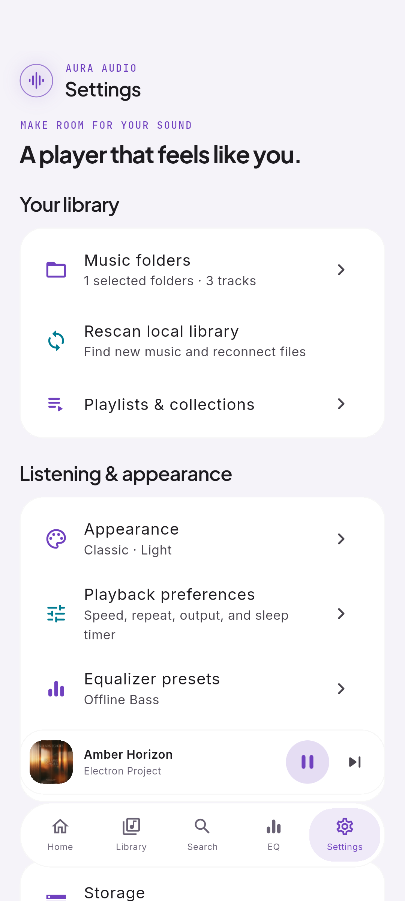
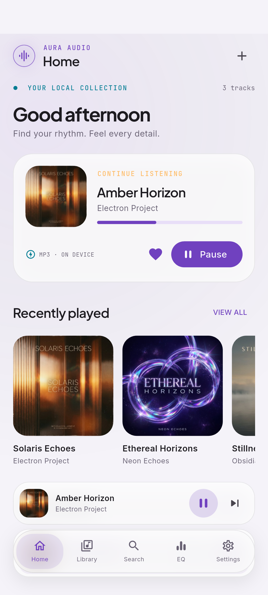
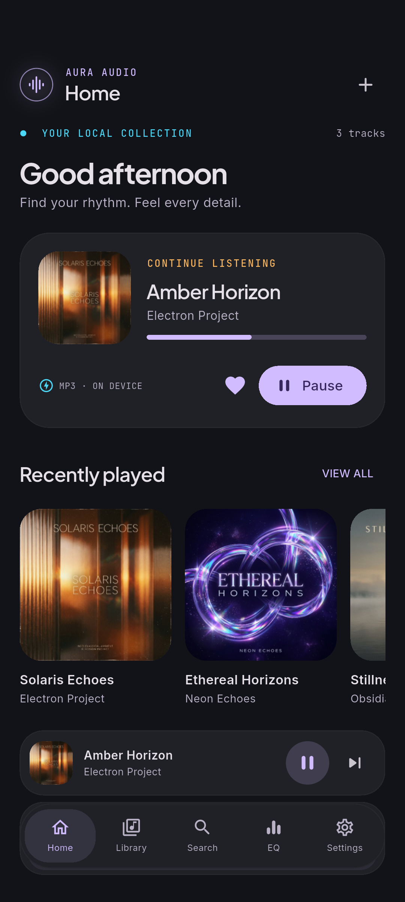

# Aura Audio

A native Flutter offline music player for Android 8.0+ (API 26). The supplied Stitch exports in `stitch_liquid_glass_music_player/` are preserved as visual references. The app uses Flutter widgets, bundled fonts and icons, and locally extracted album artwork.

## Screenshots

Android emulator captures with locally stored sample music. Click any screenshot to open the full-size image.

### Liquid Glass · Dark

| Home | Now Playing | Equalizer |
|:---:|:---:|:---:|
| <a href="docs/screenshots/glass-dark-home.png"></a> | <a href="docs/screenshots/glass-dark-player.png"></a> | <a href="docs/screenshots/glass-dark-eq.png"></a> |

### Classic · Light

| Library | Queue | Settings |
|:---:|:---:|:---:|
| <a href="docs/screenshots/classic-light-library.png"></a> | <a href="docs/screenshots/classic-light-queue.png"></a> | <a href="docs/screenshots/classic-light-settings.png"></a> |

### More theme options

| Liquid Glass · Light | Classic · Dark |
|:---:|:---:|
| <a href="docs/screenshots/glass-light-home.png"></a> | <a href="docs/screenshots/classic-dark-home.png"></a> |

Browse [all theme and screen captures](docs/screenshots/).

## Run and build

Validated toolchain: Flutter 3.47.0 / Dart 3.13.0, Android SDK, and Android Studio's bundled JDK. Development dependency resolution needs internet access. The installed release app does not.

```powershell
flutter pub get
flutter run -d <android-device-id>
flutter build apk --release
adb install -r build/app/outputs/flutter-apk/app-release.apk
```

The local release APK uses the development signing key so it can be installed and reviewed immediately. Configure your own release signing key before distribution. No credentials, environment variables, API keys, accounts, or backend are needed.

## Import your music

Choose **Music folder** for persistent read-only access to a local folder and its subfolders. Android's Storage Access Framework retains the URI grant across restarts. Alternatively, import individual files or grant music access and scan Android's MediaStore. The picker requests local providers only; Aura accepts Android's local storage, downloads, and media providers. Music is referenced in place, never uploaded or deleted.

The scanner extracts title, artist, album, duration, track number, embedded cover art, and an artwork accent locally on a worker. Missing tags use filename / Unknown artist / Unknown album. Artwork is resized to at most 512 pixels and cached privately. Flutter's decoded image cache is bounded to 40 MB / 120 images. Deduplication uses title, artist, album, duration, and byte size to merge aliases from MediaStore and selected folders. Durable folder references take precedence.

MP3, M4A/AAC, FLAC, WAV, Ogg, Opus, 3GP, and AMR are discovered. Actual container/codec support depends on Media3 and the device's Android decoders. Unsupported or unreadable files are skipped with feedback. DRM, DSD, exotic codecs, network URLs, streaming, and cloud providers are not supported. Unknown artwork uses a bundled Flutter-drawn album placeholder.

Rescan after changing files. Saved references are checked after restart and foregrounding. Deleted files and revoked grants remain visible as unavailable rather than silently breaking playlists; grant access again and rescan. Broad music permission denial can be worked around by choosing a folder or individual files. No all-files access is requested.

## Audio architecture

`PlaybackService` owns exactly one Media3 ExoPlayer and MediaSession. Flutter communicates through `aura/native` and receives authoritative state on `aura/events`. Play/pause, skip, seeking, shuffle, repeat, speed, queue changes, and system controls all address that session. The Activity's destruction releases its controller without stopping background music. Theme changes and navigation never create a player.

The service provides local Android media notifications and lock-screen/media-button integration. It manages audio focus and pauses on headphone disconnection. Android controls Bluetooth, speaker, and USB routing; the output action opens the system volume/output panel (or sound settings fallback). It does not invent output devices, spatial audio, USB passthrough, sample-rate locks, or bit-perfect claims.

Queue order, current index/position, shuffle, repeat, and playback speed are stored by the service, including a five-second checkpoint. A new service restores the queue and position **paused**. It does not unexpectedly start music. Sleep timers run in the native service and work while backgrounded. A process death cancels an outstanding timer; it also stops playback. Timers are not restored across a process restart.

Position-only events update a dedicated `ValueNotifier` for the seek bar; queue/metadata snapshots are sent on actual state changes. All widgets subscribe to the same music store. Tab widgets and their scroll state stay mounted in an `IndexedStack`. Listening history is also recorded in the native service, then merged when the UI returns, so Android can destroy the Activity without losing background listening history.

## Real equalizer

Ten native cascaded peaking biquads at **31, 62, 125, 250, 500, 1000, 2000, 4000, 8000, and 16000 Hz**, Q 1.4, ±12 dB, plus ±12 dB preamp. This is custom Kotlin DSP in Media3's PCM processor chain, separate from Flutter's UI isolate. Android's device-dependent five-band Equalizer is not used. Processing uses double precision internally and PCM16 output, so this is not a bit-perfect high-resolution output path.

Continuous slider changes are sent at a bounded 35 ms cadence, including while a gesture is still active. Settings are atomically published to the audio thread, with coefficients and gain interpolated over 40 ms. Positive filter boosts reserve conservative automatic headroom; a soft peak limiter handles high preamp levels. The response graph is calculated natively from the same coefficients, current sample rate, preamp, and headroom. It represents the linear small-signal response before the peak limiter. Bands at or above the current audio's Nyquist frequency are disabled and shown as unavailable instead of being relabeled or retuned.

Flat, Bass Boost, Vocal, Rock, Pop, Jazz, Classical, and named custom presets are local. Custom presets support save, rename, delete, and reset. EQ state persists while bypassed and across restarts. No fake or decorative audio-reactive visualizer is shown.

## Local data and lyrics

Library references, favorites, favorite albums, playlists/artwork/order, history, recent searches, themes, accessibility preferences, and presets are saved in an atomic private JSON file. Native queue/EQ state uses private Android preferences. Android backup is disabled. Uninstalling removes Aura's data; source audio remains untouched.

Matching `.lrc` or `.txt` files beside music in a selected folder are read locally. Lyrics can also be imported from Now Playing → Lyrics. LRC timestamps support synchronized active-line highlighting and tap-to-seek; plain text is displayed without fabricated timing. Missing lyrics show an unavailable state. Embedded ID3 lyric frames are not currently parsed.

## Themes and accessibility

Liquid Glass and Classic share every screen, control, and geometry, with System / Light / Dark appearances. Appearance previews use the same bundled artwork. Liquid Glass has local ambient color and localized panel blur; Classic uses opaque surfaces. Reduced transparency disables expensive blur and ambient layers. Reduced motion and system animation preferences shorten navigation, dock, sheet, and artwork transitions. Material icons, Plus Jakarta Sans, Inter, JetBrains Mono, their licenses, and onboarding artwork are bundled; no runtime font or image downloads occur.

The release manifest deliberately has **no INTERNET permission**. Flutter's debug/profile manifests retain the SDK's development connection permission for hot reload and test tooling. Neither mode contains online integrations, analytics, advertisements, login, push notifications, remote databases, or network application code.

## Code map

- `lib/features/`: library/home/search, player/lyrics/queue, playlists, equalizer, settings/appearance.
- `lib/application/music_store.dart`: shared application state and persistence coordination.
- `lib/core/models.dart`: local models, presets, LRC parsing.
- `lib/platform/native_audio.dart`: replaceable audio/platform boundary.
- `lib/presentation/`: shared visual tokens, controls, navigation, and sheets.
- `android/app/src/main/kotlin/audio/aura/aura_audio/`: scanner, service, channel integration, PCM processor, and testable filter math.

Android is the implemented platform. The Flutter/platform boundary is suitable for a future iOS backend, but no iOS audio engine or iOS project is delivered. Do not treat the interface as proof of iOS playback or EQ support.

## Validation

```powershell
dart format --output=none --set-exit-if-changed lib test integration_test test_driver
flutter analyze --no-pub
flutter test --no-pub
cd android
.\gradlew.bat :app:testDebugUnitTest
cd ..
```

The emulator fixtures are original multitone files, excluded from app assets. To recreate them, install development-only Python packages `imageio-ffmpeg` and `mutagen`, then run `python tools/generate_fixtures.py`. Push them into an emulator's Music folder, media-scan them, grant audio/notification permissions, and enable airplane mode before running:

```powershell
flutter drive --target integration_test/offline_test.dart --driver test_driver/integration_test.dart -d emulator-5554 --keep-app-running
```

The integration test uses the real Android engine, checks metadata/artwork, seeking, queue edits, native EQ/bypass, saved presets, playlist/settings persistence, and theme switching during playback. It captures Home, Library, Now Playing, EQ, Queue, and Settings in all four theme/appearance combinations under `docs/screenshots/`.

For the localized glass / reduced-transparency scrolling comparison:

```powershell
flutter drive --profile --no-dds --target integration_test/performance_test.dart --driver test_driver/performance_test.dart -d emulator-5554 --keep-app-running
```

The measured emulator results and their limits are recorded in `docs/performance.json` and the verification report. Run Android builds sequentially; switching between release and integration-test targets should allow Flutter's normal dependency/plugin setup to run.

See [verification report](docs/VERIFICATION.md) for the observed results, restart checks, and hardware-dependent work that remains unverified. Emulator PCM/DSP checks do not establish physical-device audio quality, listening comfort, Bluetooth behavior, phone-call interruptions, or long-duration battery/performance acceptance.

## Primary implementation references

- [Media3 release and setup](https://developer.android.com/jetpack/androidx/releases/media3) — pinned to 1.11.1.
- [Background playback and MediaSessionService](https://developer.android.com/media/media3/session/background-playback).
- [Durable document and folder access](https://developer.android.com/training/data-storage/shared/documents-files).
- [Android media permissions and MediaStore](https://developer.android.com/training/data-storage/shared/media).
- [Media3 BaseAudioProcessor](https://github.com/androidx/media/blob/1.11.1/libraries/common/src/main/java/androidx/media3/common/audio/BaseAudioProcessor.java).

Bundled fonts retain their SIL Open Font License files under `assets/fonts/`. Original Stitch assets and exports remain in their original directory.
